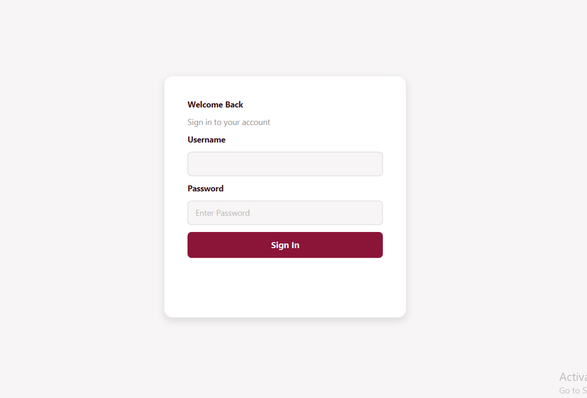
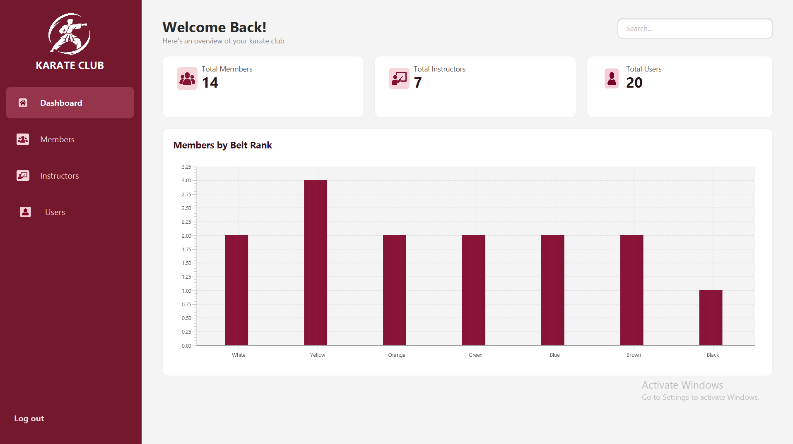
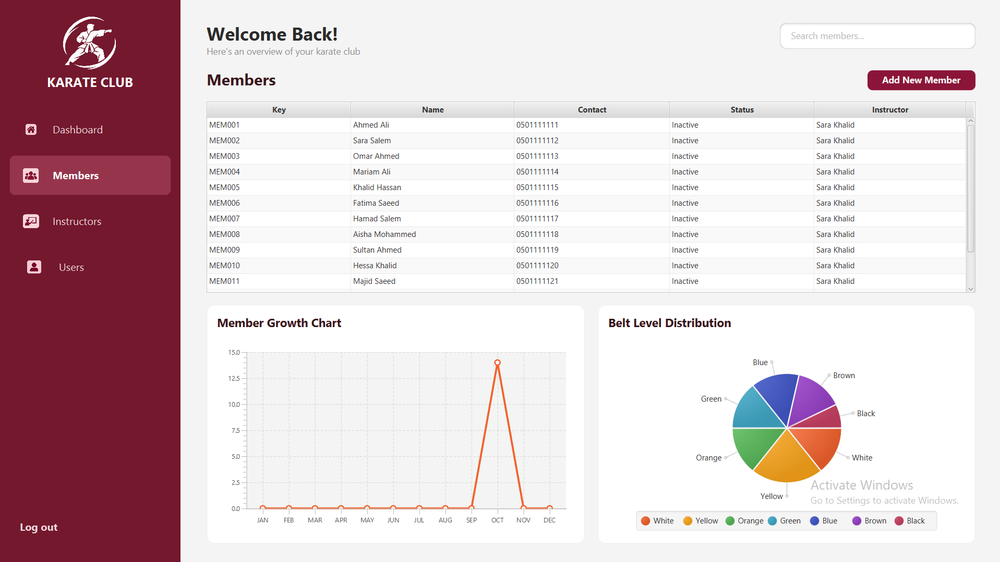
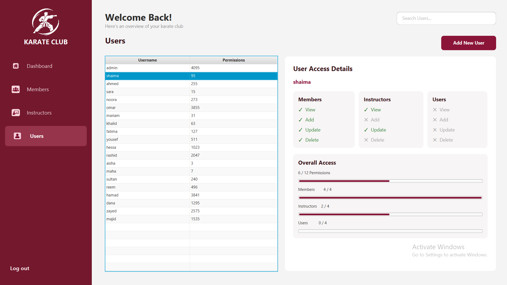
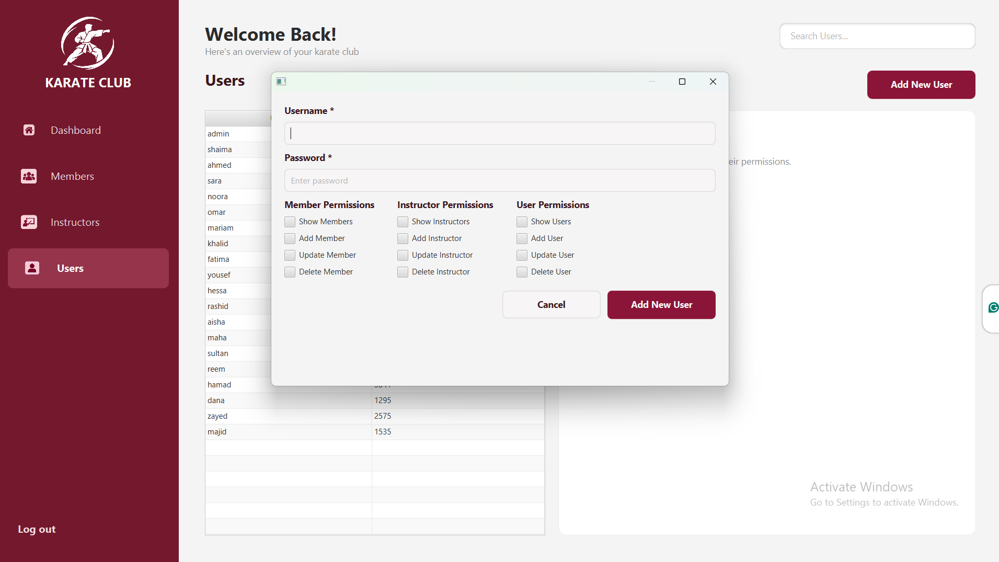
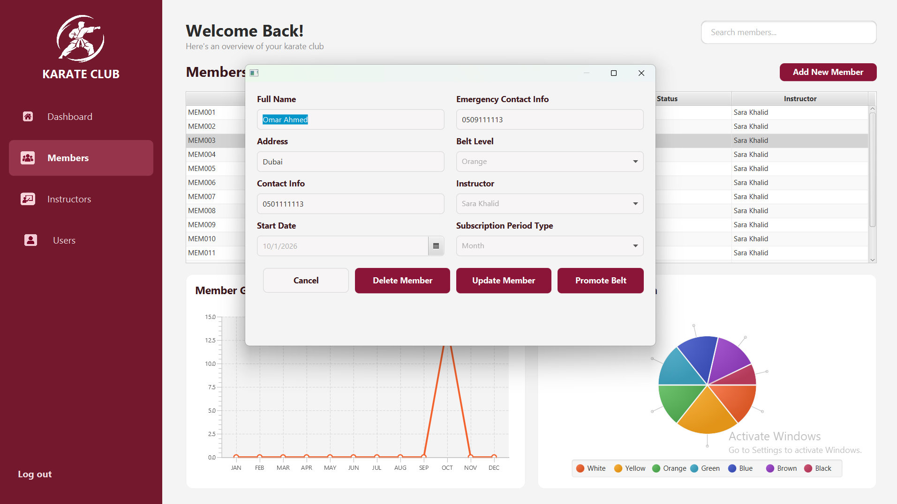

 Karate Club Management System

A JavaFX desktop application built with Java, designed to manage karate club operations while demonstrating strong Object-Oriented Programming (OOP) principles, layered software architecture, and real-world business logic.

Key Technical Highlights

Three-Layer Architecture

Designed using a structured three-layer architecture that separates the Presentation Layer, Business Layer, and Data Access Layer, improving maintainability, modularity, and separation of concerns.

Advanced Permission Management

Implemented a bitwise permission system that provides fine-grained access control for different operations. Each user can be assigned specific permissions to view, add, update, or delete members, instructors, and system users.

Business Rules and Validation

Developed business logic that enforces real-world club constraints:

Instructor Capacity: Automatically prevents assigning additional members when an instructor reaches the 15-student limit.

Belt-Based Instructor Matching: Filters available instructors according to the belt level they teach.

Belt Promotion: Handles belt progression through defined eligibility rules, including subscription status and promotion requirements.

Data Integrity: Prevents deleting instructors who still have registered students.

Subscription Management: Calculates subscription periods, fees, and membership status.

Object-Oriented Design
Applied inheritance, encapsulation, and composition throughout the system. Used a shared Person superclass for members, instructors, and users, and integrated SubscriptionPeriod objects into the member model.

Interactive JavaFX Dashboard
Developed a graphical dashboard with dynamic statistics, membership growth visualizations, and belt-level distribution charts, alongside a consistent user interface and reusable UI components.

File-Based Data Persistence

Implemented a custom data access layer using Java File I/O to persist and retrieve application records without relying on an external database.

Technologies

Java | JavaFX | OOP | Three-Layer Architecture | Bitwise Operations | File I/O | Java Collections | JavaFX Charts

This project emphasizes software design, business-rule enforcement, access control, and maintainable architecture, going beyond basic CRUD functionality to model practical karate club management operations.

## Application Screenshots

### Login Page

### Dashboard

### Members Management

### Users Management

### Add User

### Update Member

